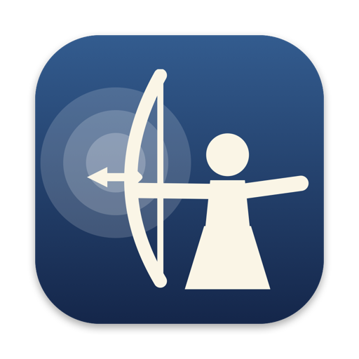

<p align="center">
  
</p>
<p align="center">
  <a href="https://github.com/ohsawa0515/hanare/releases/latest"></a>
  
  
  <a href="LICENSE"></a>
</p>

# Hanare

English | [日本語](README.ja.md)

Hide menu bar icons.


Hanare (離れ) is the release in Japanese archery (kyudo). An archer in hakama stands in your menu bar and keeps the icons you don't need hidden. Hover over the archer and it draws the bow (会, *kai*): the icons you use often appear. Click it and the arrow is released (離れ, *hanare*) and all hidden icons appear one after another. You choose which icons to hide, and which of them also appear on hover, in Settings.

## Requirements

- macOS 27 Golden Gate or later (Apple silicon)

## Install

### Homebrew

```sh
brew install --cask ohsawa0515/tap/hanare
```

### Manual

Download `Hanare-<version>.zip` from [Releases](https://github.com/ohsawa0515/hanare/releases), unzip it, and move `Hanare.app` to `/Applications`.

### First launch

Hanare is not notarized. On first launch macOS blocks it; open System Settings > Privacy & Security and click "Open Anyway".

On first launch Hanare asks for access to two files that macOS protects: the list of apps allowed in the menu bar and the menu bar order. Select each file in the window that opens. Hanare can use only these two files, and no Full Disk Access is needed. You can also allow it later from Settings. Optionally allow Hanare under System Settings > Privacy & Security > Accessibility too, which enables Command-dragging icons (see below).

On launch, the icons to the left of the archer are hidden, so the menu bar layout you arranged is the one that applies.

## Usage

| Action | Result |
| --- | --- |
| Hover over the archer | Shows the hidden icons marked "Also show on hover"; they hide again when the pointer leaves the menu bar |
| Click the archer | Show all hidden icons / hide them again |
| Command-drag an icon to the left of the archer | That icon is hidden (needs Accessibility) |
| Command-drag a revealed icon to the right of the archer | That icon is no longer hidden (needs Accessibility) |
| Right-click the archer | Menu (show all icons, settings, quit) |

Choose the icons to hide in Settings, or by dragging. Press the cursor button next to a hidden icon in Settings to also show it on hover. An icon you choose in Settings is also moved next to the archer's left side, without moving the pointer, so what is hidden always sits to its left. "All Apps" chooses every app at once. Wi-Fi, Sound, Battery, Display, Bluetooth, Now Playing and the input menu are listed under System, and every app that has a menu bar icon under Apps.

In Settings you can choose the character (male archer, female archer, or a simple chevron), how long until icons are hidden again, and launch at login.

## How it works

On macOS 27 the menu bar is drawn by the system as a single window, so the techniques used by earlier menu bar managers no longer work. Hanare turns icons off and on through the same settings that System Settings > Menu Bar uses, and the system applies them immediately. Where icons are comes from the order the system keeps for the menu bar, which Hanare also rewrites to move icons.

- Icons are hidden per app. If an app has several icons, all of them are hidden together.
- The microphone and camera indicator and the clock cannot be hidden.
- Hanare only restores what it hid. Icons you turned off in System Settings stay off.
- Hidden icons are restored when Hanare quits, and on the next launch if it ended unexpectedly. You can also choose "Show All Icons" from the menu at any time.
- Hanare relies on undocumented system settings, so a future macOS update may break it.

## Build

```sh
swift build        # debug build
swift test         # unit tests
swift run Hanare   # run without packaging
./scripts/build-app.sh  # dist/Hanare.app and dist/Hanare-<version>.zip
```

Requires Xcode 27 or later.

## License

- Source code is licensed under [GPL-3.0](LICENSE).
- Character artwork is licensed under [CC BY-NC-SA 4.0](LICENSE-ASSETS.md).
